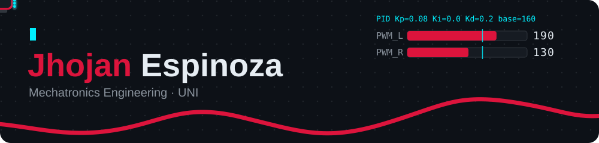
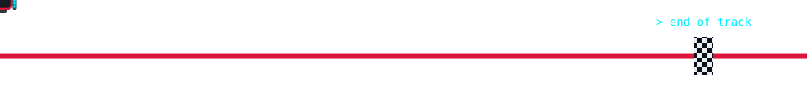

  

  <b>Mechatronics Engineering student at UNI · Embedded firmware for competitive robots</b>

  
  
  <!-- TODO: completar y descomentar
  
  
  -->

## About me

I write the firmware that makes competition robots move: line followers, mini-sumo and robot soccer. Most of my work runs on bare-metal **ATmega328P**, **ESP32** and **STM32**, where I care about tight control loops, clean timer configuration and code that is modular enough to reuse from one robot to the next.

- **Now:** Nova 6, a line follower with bare-metal timers, PD control, BTN9960LV H-bridges and a brushless suction fan.
- **Learning:** control theory beyond PID, to tune robots by model instead of by trial and error.
- **Open to:** collaborating on embedded systems, robotics and control projects.

## Featured projects

<table>
  <tr>
    <td width="50%" valign="top">
      <a href="https://github.com/JhojanECO/Nova-6"><b>Nova 6 · Line follower</b></a> 
      Modular PlatformIO firmware with calibration, PD control and four diagnostic modes. Bare-metal timers, BTN9960LV drivers and an ESC-driven brushless fan. 
      <code>C++</code> <code>ATmega328P</code> <code>PlatformIO</code>
    </td>
    <td width="50%" valign="top">
      <a href="https://github.com/JhojanECO/Nova-5"><b>Nova 5 · Line follower</b></a> 
      Separate race and diagnostic builds, PD control, suction fan and an emergency stop when the line is lost. 
      <code>C++</code> <code>ATmega328P</code> <code>PlatformIO</code>
    </td>
  </tr>
  <tr>
    <td width="50%" valign="top">
      <a href="https://github.com/JhojanECO/Minisumo-Autonomo-Senior-activacionBT"><b>Mini-Sumo · Senior</b></a> 
      Autonomous mini-sumo with Bluetooth start, built on version 1 of our universal controller board. 
      <code>C++</code> <code>Bluetooth</code>
    </td>
    <td width="50%" valign="top">
      <a href="https://github.com/JhojanECO/SOCCER_SENIOR_PERUHUB_Aldair"><b>Robot Soccer · PERUHUB</b></a> 
      Senior-category soccer robot firmware written for the PERUHUB competition. 
      <code>C++</code> <code>Embedded</code>
    </td>
  </tr>
  <tr>
    <td width="50%" valign="top">
      <a href="https://github.com/JhojanECO/computer-vision-box-counter"><b>Computer-vision box counter</b></a> 
      Box detection and counting with a YOLO26 model. 
      <code>YOLO26</code> <code>Computer vision</code>
    </td>
    <td width="50%" valign="top">
      <!-- TODO: enlace de NOVATECH UNI -->
      <a href="#"><b>NOVATECH UNI · Website</b></a> 
      Website for NOVATECH UNI, built together with Hemsy. 
      <code>Web</code>
    </td>
  </tr>
</table>

## Interactive PID lab

A browser simulation of my line follower. Change Kp, Ki, Kd and base PWM and watch the robot hold the track or lose it, the same way I tune the real one.

  

## Tech stack

<table>
  <tr>
    <td><b>Languages</b></td>
    <td></td>
  </tr>
  <tr>
    <td><b>Microcontrollers</b></td>
    <td>
      
      
      
    </td>
  </tr>
  <tr>
    <td><b>Tools</b></td>
    <td>
      
      
    </td>
  </tr>
</table>

## GitHub activity

  

  

  

