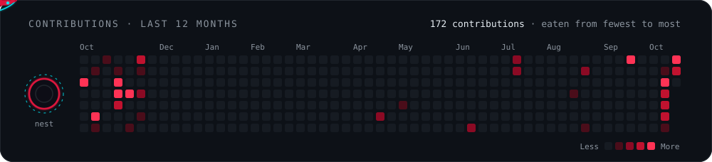

<!-- Images inside <picture> are not turned into links by GitHub; only <a> elements are clickable. -->

  <picture></picture>

  <b>Mechatronics Engineering student at UNI · Embedded firmware for competitive robots</b>

  
  <picture></picture>
  <!-- TODO: completar y descomentar
  
  
  -->

<picture></picture>

## About me

I write the firmware that makes competition robots move: line followers, mini-sumo and robot soccer. Most of my work runs on bare-metal **ATmega328P**, **ESP32** and **STM32**, where I care about tight control loops, clean timer configuration and code that is modular enough to reuse from one robot to the next.

- **Now:** a line follower with bare-metal timers, PD control, BTN9960LV H-bridges and a brushless suction fan.
- **Learning:** control theory beyond PID, to tune robots by model instead of by trial and error.
- **Open to:** collaborating on embedded systems, robotics and control projects.

## Featured projects

<table>
  <tr>
    <td width="50%" valign="top">
      <a href="https://github.com/JhojanECO/Minisumo-Autonomo-Senior-activacionBT"><b>Mini-Sumo · Senior</b></a> 
      Autonomous mini-sumo with Bluetooth start. PID control ported from Arduino to ESP32, with separate modules for sensors, motors, status LED and fight strategy. 
      <code>C++</code> <code>ESP32</code> <code>PlatformIO</code>
    </td>
    <td width="50%" valign="top">
      <a href="https://github.com/JhojanECO/SOCCER_SENIOR_PERUHUB_Aldair"><b>Robot Soccer · PERUHUB Senior</b></a> 
      Firmware for a senior-category soccer robot driven with a PS5 controller over classic Bluetooth, built for the PERUHUB competition. 
      <code>C++</code> <code>ESP32</code> <code>Bluetooth</code>
    </td>
  </tr>
  <tr>
    <td width="50%" valign="top">
      <a href="https://github.com/JhojanECO/esp32_soccer_amateur"><b>Robot Soccer · Amateur</b></a> 
      Bluetooth-controlled ESP32 soccer robot, with a step-by-step guide so new team members can build and flash it. 
      <code>C++</code> <code>ESP32</code> <code>PlatformIO</code>
    </td>
    <td width="50%" valign="top">
      <a href="https://github.com/JhojanECO/Frecuency_all_timers"><b>High-frequency PWM · ATmega328P</b></a> 
      Configures Timer0, Timer1 and Timer2 for fast PWM with a small API to set each channel's duty cycle directly. 
      <code>C++</code> <code>ATmega328P</code> <code>Bare-metal</code>
    </td>
  </tr>
</table>

## Interactive PID lab

A browser simulation of my line follower. Change Kp, Ki, Kd and base PWM and watch the robot hold the track or lose it, the same way I tune the real one.

  

## Tech stack

<table>
  <tr>
    <td><b>Languages</b></td>
    <td><picture></picture></td>
  </tr>
  <tr>
    <td><b>Microcontrollers</b></td>
    <td>
      <picture></picture>
      <picture></picture>
      <picture></picture>
    </td>
  </tr>
  <tr>
    <td><b>Tools</b></td>
    <td>
      <picture></picture>
      <picture></picture>
    </td>
  </tr>
</table>

## GitHub activity

  <picture></picture>

  <picture></picture>

