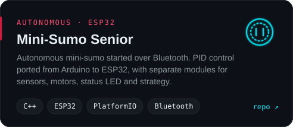
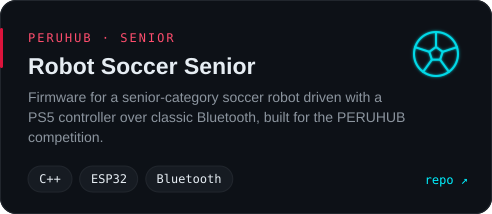
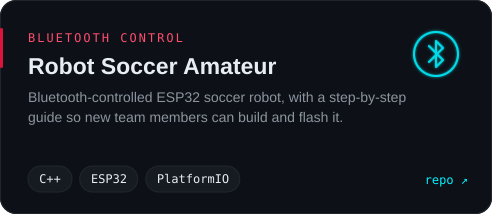
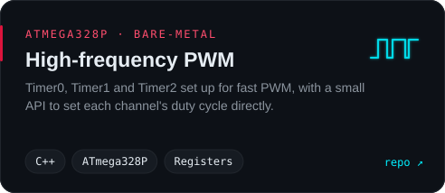
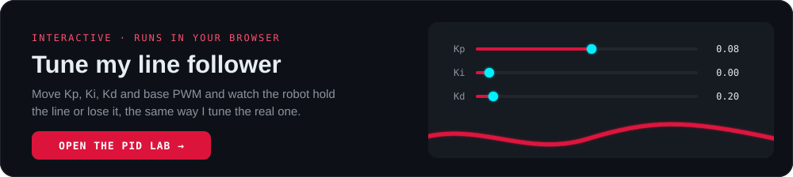
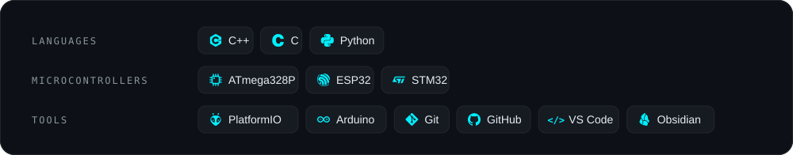

<!-- Images inside <picture> are not turned into links by GitHub; only <a> elements are clickable.
     Cards are generated: tools/cards.py (static), tools/stats_card.py and tools/dragon_contrib.py (daily). -->

  <picture></picture>

  
  <picture></picture>
  <!-- TODO: completar y descomentar
  
  
  -->

<picture></picture>

  <picture></picture>

<picture></picture>

  
  
  
  

<picture></picture>

  

<picture></picture>

  <picture></picture>

<picture></picture>

  <picture></picture>

  <picture></picture>

